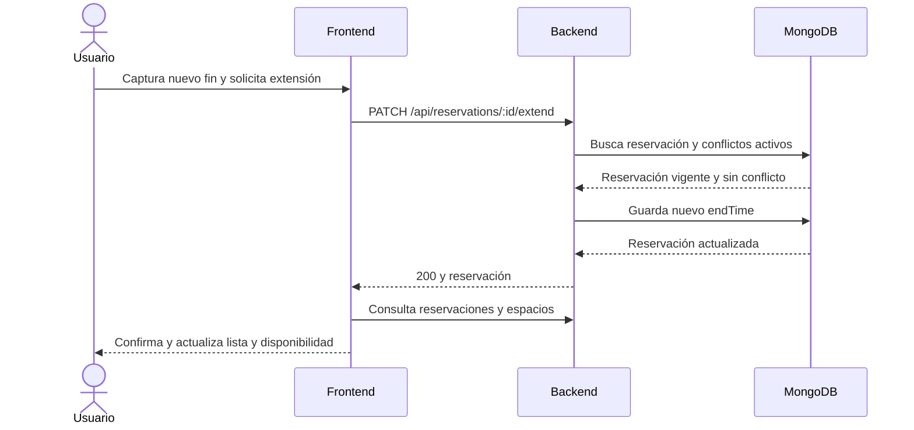
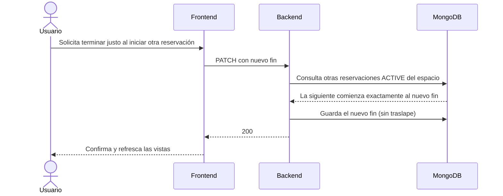

# Práctica integradora 2: diseño previo

## Historia y reglas

Como usuario, quiero ampliar el fin de una reservación activa y vigente para conservar el espacio sin crear otra reservación. La operación modifica solo `endTime`. El ID debe identificar una reservación; debe estar ACTIVE y su fin debe ser posterior al momento actual. La fecha solicitada debe ser válida y posterior al fin actual. No puede haber otra reservación ACTIVE del mismo espacio que se traslape; se excluye la propia reservación y se ignoran las canceladas. Los intervalos adyacentes son válidos. Ante un rechazo no se guarda ningún cambio.

## Flujos



```mermaid
sequenceDiagram
 actor Usuario
 participant UI as Frontend
 participant API as Backend
 participant DB as MongoDB
 Usuario->>UI: Solicita extensión inválida
 UI->>API: PATCH con ID y nuevo fin
 API->>DB: Busca reservación y, si aplica, conflictos
 DB-->>API: Resultado de consulta
 API-->>UI: 400, 404 o 409; no guarda
 UI-->>Usuario: Explica el rechazo
```



## Casos diseñados antes de implementar

En cada caso se invoca PATCH con la entrada indicada y se verifica el código, la respuesta y si se guardó el cambio. Para las pruebas unitarias se controlan el reloj y las consultas; los resultados reales se registrarán después.

| ID | Nombre | Precondiciones | Entrada | Pasos | Resultado esperado | Tipo | Resultado obtenido |
|---|---|---|---|---|---|---|---|
| P01 | Extensión libre | ACTIVE y fin futuro | Fin posterior válido | Enviar solicitud | 200; guarda y devuelve nuevo fin | Happy Path | Aprobado: HTTP y MongoDB aislado |
| P02 | ID inválido | Ninguna | ID no localizable | Enviar solicitud | 404; no guarda | Error Case | Aprobado: HTTP y MongoDB aislado |
| P03 | Reservación inexistente | ID válido sin documento | Fin válido | Enviar solicitud | 404; no guarda | Error Case | Aprobado: HTTP y MongoDB aislado |
| P04 | Cancelada | Reservación CANCELLED | Fin posterior | Enviar solicitud | 409; no guarda | Error Case | Aprobado: HTTP y MongoDB aislado |
| P05 | Finalizada | Fin anterior al reloj | Fin posterior | Enviar solicitud | 409; no guarda | Error Case | Aprobado: HTTP y MongoDB aislado |
| P06 | Fecha inválida | ACTIVE y vigente | Texto no convertible | Enviar solicitud | 400; no guarda | Error Case | Aprobado: HTTP y MongoDB aislado |
| P07 | Fecha ausente o tipo incorrecto | ACTIVE y vigente | Sin fecha, null o número | Enviar solicitud | 400; no guarda | Error Case | Aprobado: Jest (ausente, null y número); HTTP (null) |
| P08 | Fin anterior | ACTIVE y vigente | Fecha menor al fin actual | Enviar solicitud | 400; no guarda | Error Case | Aprobado: HTTP y MongoDB aislado |
| P09 | Fin idéntico | ACTIVE y vigente | Fecha igual al fin actual | Enviar solicitud | 400; no guarda | Edge Case | Aprobado: HTTP y MongoDB aislado |
| P10 | Conflicto activo | Otra ACTIVE en el mismo espacio se traslapa | Fin dentro de la otra reserva | Enviar solicitud | 409; no guarda | Error Case | Aprobado: HTTP y MongoDB aislado |
| P11 | Fin adyacente | Otra ACTIVE comienza al nuevo fin | Fin igual al inicio siguiente | Enviar solicitud | 200; guarda | Edge Case | Aprobado: HTTP y MongoDB aislado |
| P12 | Reserva cancelada | Otra CANCELLED se traslapa | Fin posterior | Enviar solicitud | 200; guarda | Edge Case | Aprobado: HTTP y MongoDB aislado |
| P13 | Exclusión de sí misma | No hay otras reservaciones | Fin posterior | Enviar solicitud | 200; no se considera conflicto propio | Edge Case | Aprobado: HTTP y MongoDB aislado |
| P14 | Otro espacio | Otra ACTIVE se traslapa en distinto espacio | Fin posterior | Enviar solicitud | 200; guarda | Edge Case | Aprobado: HTTP y MongoDB aislado |
| P15 | Fin actual igual al reloj | ACTIVE cuyo fin coincide con ahora | Fin posterior | Enviar solicitud | 409; no guarda | Edge Case | Aprobado: Jest |
| P16 | Interfaz exitosa | ACTIVE vigente | Fin posterior disponible | Enviar desde formulario | Confirma y refresca lista, agenda y espacios | Happy Path | Aprobado: navegador y MongoDB aislado |
| P17 | Interfaz rechazada | Conflicto o datos inválidos | Fin rechazado | Enviar desde formulario | Muestra mensaje comprensible sin confirmar éxito | Error Case | Aprobado: navegador y MongoDB aislado |

## Implementación y evidencia preparada

- `reservation.rules.ts`: valida la vigencia y el nuevo fin ISO con zona horaria, incluyendo fechas de calendario inválidas.
- `reservation.service.ts`: localiza la reservación, aplica las reglas, consulta conflictos de otras reservaciones activas del mismo espacio y guarda el nuevo fin.
- `reservation.routes.ts`: conecta el endpoint PATCH y transforma errores de negocio en respuestas HTTP.
- `parking.js` y `styles.css`: muestran el formulario de extensión, envían la solicitud, informan el resultado y refrescan las vistas.
- `reservation.extend.test.ts`: pruebas nuevas de la regla y del servicio, con preparación, ejecución y comprobación; no se modificaron las pruebas previas.

## Resultados de verificación

- `npm run build`: compilación correcta.
- `npm test`: 2 suites y 45 pruebas aprobadas (19 previas y 26 nuevas).
- Una comprobación HTTP contra MongoDB aislado verificó persistencia, adyacencia, exclusión de la propia reservación, canceladas, otro espacio, errores 400, 404 y 409, y ausencia de cambios ante rechazos.
- Una comprobación en navegador con MongoDB aislado verificó éxito, fecha anterior y conflicto de horario.

Las capturas para el PDF y la reflexión personal del estudiante quedan pendientes. Para documentar la comprobación reproducible se pueden capturar las salidas de compilación y Jest y los escenarios desde la interfaz o DevTools.
